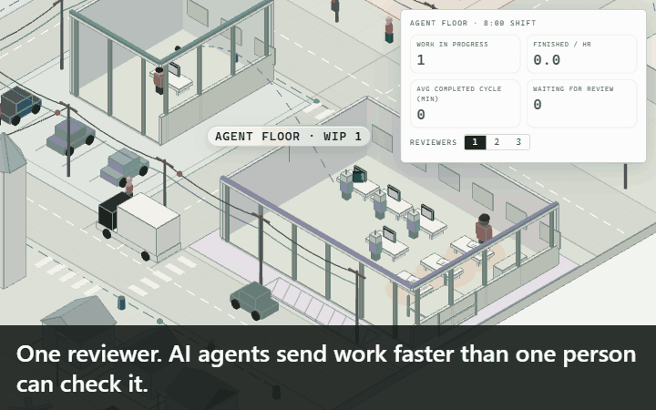
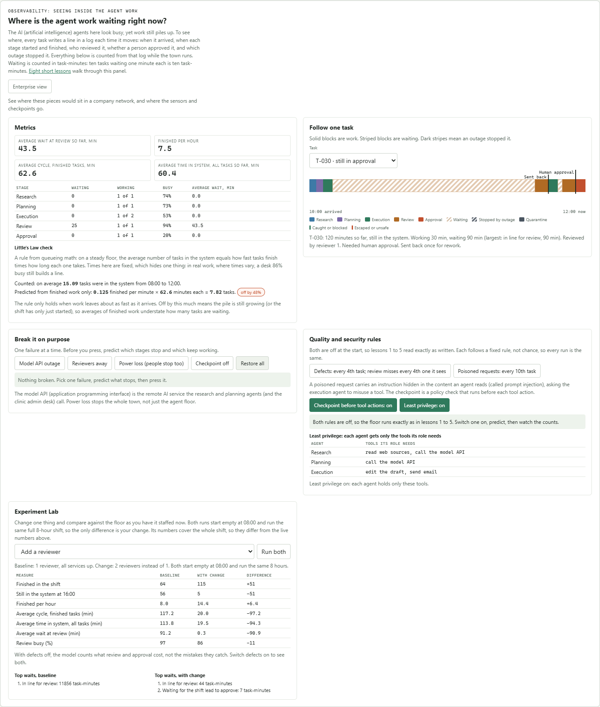

# Kestrel Harbor

**See where AI agent work waits, fails and needs a person, in a small town you can break on purpose.**



**Try it live:** open the website link in this repository's About panel (on GitHub, top right on desktop, under the repository name on a phone). It runs in the browser, and the lessons are under `/lessons/`. It also runs offline: download the repository and open `index.html`.

Kestrel Harbor is a free, offline practicum for owners and operators who use AI (artificial intelligence) agents and are not engineers. A model town runs on one clock: trucks, a bike plant, a clinic desk and an agent floor where agents research, plan and carry out tasks, people review the work, and a shift lead approves some of it. Every task leaves a trace, so you can watch where the work piles up, what a check catches, and what a checkpoint stops.

## Try it in 60 seconds

1. Download or clone this repository.
2. Open `index.html` in a desktop or phone browser. No install, no internet, no account. (The 3D town needs WebGL; the panels work without it.)
3. Press **Reviewers 1**, set speed to **20×**, and scroll to **Where is the agent work waiting right now?**
4. Under **Break it on purpose**, predict what stops, then press **Model API outage**.
5. Press **Enterprise view** to see the same pieces as a company network, with its sensors and checkpoints.



## What you will learn

- Where agent work waits, and why faster agents do not finish more.
- What one task's trace shows that an average on a dashboard hides.
- How to read Little's Law on an agent floor, and what it means when it stops matching.
- What keeps moving, and what stalls, when a service or a person is missing.
- What a human approval step costs, what it catches, and what still escapes.
- Where to put sensors (places that record) and checkpoints (places that can stop) in a company network.
- How instructions hidden in what an agent reads can steer it, and why a check before the action matters more than one after.

## Eight lessons in three parts

Each lesson takes about ten minutes on a phone, asks you to predict before it reveals, sends you into the town to break something, and ends with one thing to check in your own work on Monday. Each also ends with an optional **Build it yourself with AI** section: the one rule, a starter prompt you can give any AI assistant to build a tiny single-file version, and the numbers your version must reproduce, so you learn to check an AI's work. Start at [`lessons/index.html`](lessons/index.html).

**Simulate:** [the town](index.html) itself.

**Observe**
1. [Where does agent work wait?](lessons/01-where-work-waits.html)
2. [What does a trace show that a dashboard hides?](lessons/02-trace-vs-dashboard.html)
3. [Why does adding tasks not add output?](lessons/03-littles-law.html)
4. [What stops, and what keeps moving, when something fails?](lessons/04-failure-modes.html)

**Govern and secure**

5. [Where should a person decide?](lessons/05-human-decision.html)
6. [Who decided, and can you prove it?](lessons/06-who-decided.html)
7. [Where do the sensors and checkpoints go?](lessons/07-sensors-and-checkpoints.html)
8. [What happens when the input is the attack?](lessons/08-input-is-the-attack.html)

## How the model works

- One tick is one simulated minute, starting at 08:00. Nothing is random: the same settings always give the same result, so a lesson, a test and a screen recording agree.
- A task arrives every 4 minutes. Agents research (3 minutes), plan (3) and execute (4, two at a time). A person reviews (6). Every third task waits for a shift lead's approval (5). Every fifth task fails review once and goes back to execution.
- Research and planning need the internet and the model API (application programming interface), the remote service that answers the agents. Everything needs power. Review needs reviewers present.
- Two optional rule sets, both off at the start so lessons 1 to 5 read exactly as written. **Quality:** every 4th task carries a defect, and every 4th review that sees one misses it; the shift lead sees only every third task and misses every 2nd defect it sees. **Security:** every 10th task carries a hidden instruction (prompt injection); a checkpoint before the tool action sends it to a person (and lets every 3rd one through, because it looks allowed), and least privilege gives each agent only its role's tools. Both follow fixed rules, not chance.
- Every minute of every task is recorded as working or waiting, with the reason. The format is documented in [docs/EVENT-SCHEMA.md](docs/EVENT-SCHEMA.md) and can be exported in the OpenTelemetry trace layout.
- More detail, with diagrams: [docs/ARCHITECTURE.md](docs/ARCHITECTURE.md).

## Limits, stated plainly

- **Every number is illustrative.** Times and rules were chosen for teaching, not measured from any real business.
- **Times and rules are fixed.** Real work varies, and variation makes lines much longer than shown here. A desk that is 86% busy looks calm in this model and would not in real life. Defects and misses follow a fixed pattern, not real error rates.
- **The misses follow a fixed pattern.** The approver misses every 2nd defect it sees and the checkpoint lets every 3rd poisoned action through, to show that no check is perfect. Real approvers and real checks miss things unevenly, and a real check tends to miss the cases that look most like normal work, so treat these as a teaching pattern, not error rates.
- **The enterprise view is schematic and vendor-neutral.** Only the tool checkpoint is simulated; the other sensors and checkpoints are drawn to show where they would sit. No real attack text is used.
- **Outages pause work cleanly.** Real outages can lose requests that were halfway done.
- **All names, plates, businesses and tickets are fictional.**

## Run the tests

```
npm ci
npm test                      # engine, observability, lessons and release audit
npm run build                 # rebuilds index.html, factory.html, the lessons and the docs diagrams
python functional-test.py     # optional: drives the real page (Playwright + Microsoft Edge)
node scripts/audit-release.mjs .   # checks a folder for secrets, local paths, emails and hidden image text
```

`scripts/audit-release.mjs` is a small, dependency-free release audit you can point at any folder before publishing it. It looks for secret key shapes, private keys, local home-directory paths (Windows, macOS, Linux), email addresses, environment files, `node_modules` folders, symbolic links, and images that could hide text after their end or in metadata (including GIF comment and text blocks). Pass `--rules <file.json>` to add your own path, text and name checks; the file format is described at the top of the script.

## Acknowledgements and sources

- **Visual inspiration.** The white miniature town, moving traffic, inspector cards and follow camera were inspired by the architectural town posts of Khalid ([@KhalidDevLog on X](https://x.com/KhalidDevLog/status/2106957256247902272)). All geometry, code and data here are original; his source and assets were not used.
- **Open-source libraries.** [three.js](https://threejs.org/) (MIT License, copyright three.js authors) draws the 3D town and is bundled into the built pages; see [THIRD-PARTY-NOTICES.md](THIRD-PARTY-NOTICES.md). [esbuild](https://github.com/evanw/esbuild) (MIT License, copyright Evan Wallace) bundles the pages at build time and is not included in them.
- **Cited sources.** The town page's sources section links published documentation from Waymo and John Deere to ground how real vehicles and machines behave when a network is lost. They are referenced as public documentation only; no endorsement by, or affiliation with, either company is implied.

## Contributing, conduct and security

See [CONTRIBUTING.md](CONTRIBUTING.md), [CODE_OF_CONDUCT.md](CODE_OF_CONDUCT.md) and [SECURITY.md](SECURITY.md). Changes are listed in [CHANGELOG.md](CHANGELOG.md). To cite this work, use [CITATION.cff](CITATION.cff).

## License

- **Code** (the simulation, page sources, tests and tooling): Apache License 2.0. See [LICENSE](LICENSE).
- **Lessons** (lesson pages, screenshots and the animation): Creative Commons Attribution-NonCommercial 4.0 (CC BY-NC 4.0). Free to learn from, share and adapt with credit, not to resell. See [LICENSE-lessons.md](LICENSE-lessons.md).
- **Names and branding** ("Kestrel Harbor", "Notes of a Nomad") are not covered by either license. See [TRADEMARKS.md](TRADEMARKS.md).
