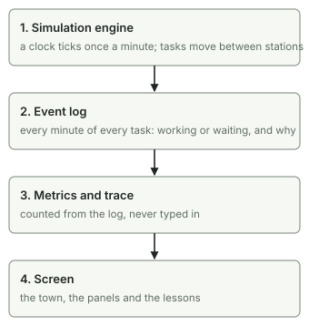
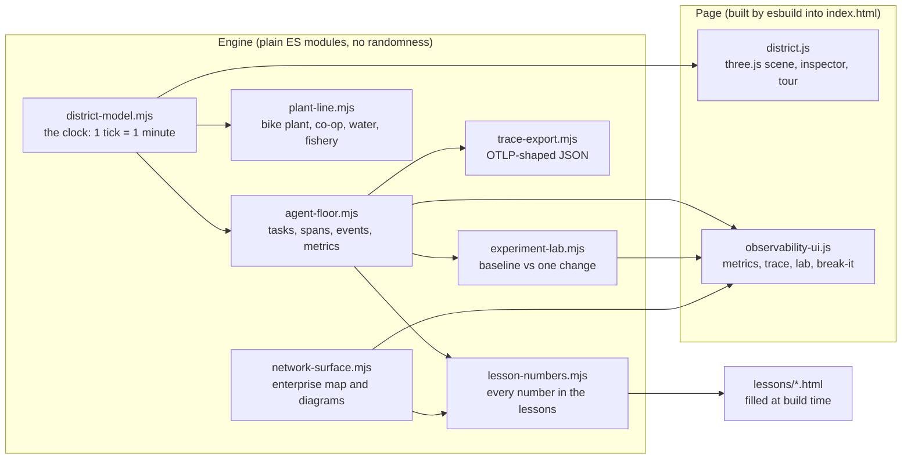
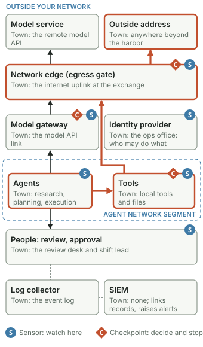

# Architecture

Kestrel Harbor is a deterministic simulation with a picture on top. The engine decides every number; the three-dimensional town and the panels only display what the engine says. There is no server, no account and no network call at runtime: `index.html` is one self-contained file.

## How the town works inside

Four layers, each fed only by the one above it. The engine moves tasks minute by minute; every move and every minute is written to the event log; metrics and the one-task trace are counted from the log; the screen (the town, the panels and the lessons) shows those counts. The diagram is drawn by `network-surface.mjs` (`townInsideSvg`), the same code that puts it in lesson 2, so its labels cannot drift. `npm run build` regenerates `docs/media/*.svg`.

## Module map

## The pieces

| File | Job |
|---|---|
| `district-model.mjs` | The clock. Ticks every part of the town once a minute and holds the services (internet, model API, power, RTK (real-time kinematic) positioning correction, reviewer presence). |
| `agent-floor.mjs` | The agent floor: arrivals, five stations, review capacity, approval and rework rules. Records a span for every task minute and an event for every move. Computes metrics, including the Little's Law check. Also the optional quality and security rules (off by default): every Nth task carries a defect and every Nth review that sees one misses it; every Nth task carries a hidden instruction, a checkpoint before the tool action sends it to a quarantine desk, and least privilege limits each role's tools. |
| `network-surface.mjs` | The enterprise view: the town's pieces mapped onto a vendor-neutral company network, the sensors and checkpoints, scripted incident paths, and the code that draws both diagrams as inline SVG (scalable vector graphics) for the page, the lessons and these docs. |
| `experiment-lab.mjs` | Runs two fresh floors from the same empty start for the same horizon, one with a single change, and reports the differences and the top waiting causes. |
| `trace-export.mjs` | Converts tasks to the OpenTelemetry Protocol (OTLP) JSON layout. See [EVENT-SCHEMA.md](EVENT-SCHEMA.md). |
| `lesson-numbers.mjs` | Computes every number quoted in a lesson; `build.mjs` fills `{{name}}` tokens in `lessons-src/` and a test fails if a built lesson drifts. |
| `observability-ui.js` | The observability section of the page. Reads only from the engine. |
| `district.js`, `networks.js`, `world-dress.js`, `layout.js`, `tour.js` | The town drawing, utilities, scenery, site plan and scripted tour. |
| `plant-line.mjs`, `model.mjs`, `app.js` | The bike plant and the original four-stage factory lesson (`factory.html`). |
| `mock-data.mjs` | Every name, plate and ticket. All fictional. |
| `scripts/audit-release.mjs` | A dependency-free release audit: secret key shapes, local paths, emails, environment files, symbolic links and images that could hide text. CI runs it on every push. |

## The enterprise view

In the page, the **Enterprise view** button (or `index.html?enterprise`) shows this map under the observability heading, with the town's live checkpoint state and counts. Only the tool checkpoint is modeled in the engine; the gateway policy and egress gate are drawn to show where they would sit.

## Rules the code keeps

- **Deterministic.** No random numbers and no wall-clock time in the engine. Same inputs, same outputs, so a lesson, a test and a recording all agree.
- **Every minute accounted for.** Tests check that each task's spans tile its life with no gaps or overlaps, and that tasks are conserved (arrived = in progress + finished).
- **Numbers come from the engine.** Panels and lessons compute what they show; nothing is typed in as a label.
- **No frameworks.** three.js for the drawing, esbuild to bundle, plain modules otherwise.

## Tests

`npm test` runs the engine, observability, lesson and release-audit tests with Node's built-in test runner. `python functional-test.py` drives the real page in a headless browser (Playwright with Microsoft Edge) and checks every control, including the observability layer on a full 8-hour shift and the phone layout.
